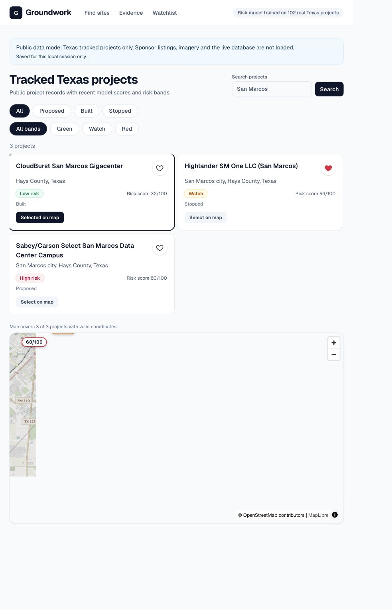

# Groundwork

Data center siting decisions depend on evidence scattered across project records and local reporting. Groundwork brings those signals into one place for an early screening review.

Groundwork helps data center developers, land investors and lenders screen property prospects before committing to land. The product direction is to find land worth buying, determine the most to pay, and identify what could kill the deal. Built at HackPrinceton Fall 2026, November 13–15.

The current property experience searches CoStar records in Houston and Los Angeles, shows recorded property facts and asking prices, and supports a separate review for each prospect. Project research provides regional context. **Purchase verdicts, a maximum purchase price, full ten-year costs and a property investment memo are not implemented yet.** The original product plan remains in [`plan/00-overview.md`](plan/00-overview.md); it describes the target, not a list of shipped features.

See the teammate-facing [change guide](docs/CHANGES.md) for the score and scenario changes, configuration, database-path review notes, and verification limits.

## Who it is for

Data center developers, land investors and lenders screening properties before paying for engineering and legal studies. The checks identify questions to investigate; they do not verify utility capacity, permits, land availability, or investment suitability.

## What works today

### Property discovery — database mode

The code contains CoStar listing search and detail pages, Vexcel aerial imagery and 3D tiles, Matterport embeds, and direct PostgreSQL/Tiger Data storage, originally built by the team at commit `f986561`. The home, listing, project, watchlist, and evidence pages are now render-tested against synthetic rows through a mocked database pool. Invented records cover each Texas score band, an unscored California listing, missing property facts, date objects, score history, and a mixed watchlist. The tests exercise the real page output and query parameterization; they reject unexpected query shapes. A rejected pool and the generic retry screen are checked separately; these static render checks do not exercise Next.js's automatic error-boundary navigation or browser interactions.

Separately, a one-off Chrome check of a fresh production build with database configuration absent showed the safe retry screen on the home and listing routes. Both returned HTTP 500; neither the rendered pages nor their raw response bodies exposed the internal error, a stack trace, or a local path. This observed missing-configuration failure routing only. A failing SQL call against a live database was not observed.

**Read-only database queries and selected page renders were verified on November 14, 2026.** A user-configured TLS connection returned 349 project rows, 349 feature rows, 799 score rows, and 158 listing rows. The app's project/listing queries and a PostGIS distance query succeeded. A local production server with PostgreSQL read-only mode enforced returned HTTP 200 for home, one listing, one project, Evidence, and the empty watchlist; the home, listing, and project were also inspected in the browser. No database writes, ingestion, schema changes, watchlist persistence, or failing live SQL recovery were exercised.

**Live Vexcel imagery/3D and Gemini remain unverified.** The listing detail rendered a Matterport warehouse embed, but its match to that property was not verified. Sponsor entitlements and provider compatibility remain open. These paths are outside the credential-free public demo. Sponsor data and credentials are not included in the repository.

At `/`, search property prospects in Houston and Los Angeles. Open `/listings/[id]` for the recorded asking price, derived asking price per acre when both inputs are available, screening checks, missing acquisition facts, and a property-specific diligence checklist. The asking price is a stored CoStar snapshot; its date and current availability are not verified. Price per acre is arithmetic on those recorded fields, not a valuation or maximum bid. The existing model is a location-context signal trained on Texas projects. Illustrative Dallas build costs and Texas electricity assumptions are not local quotes, including on LA records.

The property review stores only a property ID, user-entered notes, a next move and task ticks in `groundwork.property.v1:<siteId>`. Saving is explicit and browser-local; it does not write to the database or change model/check results. Existing project notes use separate storage. A best-effort check prevents overwriting a saved version changed by another tab; browser storage is not transactional and does not synchronize accounts or devices.

### Supporting project research

- At `/projects`, search tracked Texas projects (349 in the checked-in snapshot) by name, city, county, status, and risk band. Map pins and cards select each other; invalid coordinates are excluded from the map and unscored projects have neutral pins.
- Open a project for its model score, seven checks with rules and sources, a cost scenario at a chosen MW load, and nearby projects with lower model scores. Some checks are explicitly unknown.
- Review dated evidence with an as-of filter: ten manually reviewed records across seven rows on the evidence page. The rows cover Highlander SM One, Matrix, Project Tomahawk, Athens, Sabey and CloudBurst with county context only, and Diode Ventures with city context only. Cards and buildability checks link to their dated records.
- Save projects to a visitor-specific watchlist, compare them, and review the change feed. Live changes use the time a record was added after saving; historical replay uses the fixture publication dates.
- Inspect cross-validation metrics, observed outcomes by band, model coefficients, the statewide project map, and the retrospective case-study table on the Evidence page.
- Optionally enable private evidence intake for a local demonstration. It fetches a public HTTPS page and verifies a submitted quote against extracted page text. It does **not** verify the submitter's date, summary, or interpretation. Submitted records are context only and do not change scores or dollar scenarios.
- Optionally enable the AI investigator to produce a deterministic research plan and propose source-and-quote candidates. Each candidate must pass the guarded fetch and exact quote-match gate before it can become a private session record. The Gemini adapter is **not tested against the live service**, and no live model call has been verified. With no configured key, the plan remains visible, the Investigate button is disabled, and the panel says “Investigator is not configured.”

Public mode reads the checked-in public CSVs, model artifact, and signal fixture. It requires no database or sponsor key. Watchlists and submitted evidence live in process memory, expire after 12 hours, and disappear on restart. A visitor cookie separates sessions; it is not an account or durable identity. Public score history contains the current snapshot, not a history of past model runs. Maps require an internet connection for OpenStreetMap tiles and WebGL2; unsupported browsers show a fallback while the rest of the page remains usable.



The project index works in either mode. With the database enabled it reads tracked projects from Tiger Data; public mode uses the checked-in snapshot. The research workspace at `/workspace` always uses the checked-in public project dataset, in either mode. These projects are regional research context, not property listings or evidence about a particular CoStar parcel. The public-mode home page explains that the property catalog is unavailable and links to research.

## Run it locally

Use **Node.js 24.22.1**, the version used for verification, with npm. For property discovery, configure `DATABASE_URL` privately in your local environment or ignored root `.env`, leave `DATA_MODE` unset, then run `npm ci` and `npm run dev` from `web/`. Open `/` for prospects. Do not commit credentials.

For project research without a database, start from the repository root:

```sh
cd web
npm ci
DATA_MODE=public npm run dev
```

Open [project research](http://localhost:3000/projects). Public mode must be selected explicitly: without it, the application attempts database mode. Alternatively, set `DATA_MODE=public` in `web/.env.local`. Copying the root example to a root `.env` alone does not set Next.js's public-mode flag. See [.env.example](.env.example) for the configuration names; never commit real credentials.

Run the public-mode HTTP smoke check from `web/`:

```sh
npm run smoke
```

The smoke command requires Node 24 or newer. Its build step uses Google Fonts and needs network access to fetch fonts on a fresh build. The route checks themselves call only the local server. It builds and starts the production app on an available loopback port, exercises the public routes and save/replay flow, checks that optional/private routes stay closed, and stops the server. It requires no database or sponsor credentials. Run it in a clean checkout without local `.env` files; it refuses those files rather than letting Next.js load credentials. The command checks server-rendered HTML and HTTP behavior, not browser JavaScript, maps, or external assets. The response leak scan is conservative: literal path-like text such as `/tmp/` or `/opt/` can trigger a failure even when it is harmless source content. Inspect the failing response before treating it as an application leak.

In another terminal, from `web/`, run the code checks:

```sh
npm test
npm run typecheck
npm run lint
```

For a local production build, stop the development server, then run from `web/`:

```sh
DATA_MODE=public npm run build
DATA_MODE=public npm start
```

The production server also uses [http://localhost:3000](http://localhost:3000). The build includes database-mode routes without connecting to the database. The existing `Viewer3D.tsx` cleanup-reference lint warning remains; it does not fail the build.

Follow the [property walkthrough and supporting research demo](docs/DEMO.md). The optional evidence-intake demonstration is separate and must remain local. Training and ingestion are not needed to run the demo: the artifact is already checked in. [scripts/requirements.txt](scripts/requirements.txt) pins the model evaluation dependencies, not every dependency needed by the original ingestion scripts.

For the investigator's no-key UI check, run locally with `ENABLE_INVESTIGATOR=true` and leave `GEMINI_API_KEY` unset; the plan is visible and the button is disabled. A configured local run needs `ENABLE_INVESTIGATOR=true` and a server-side `GEMINI_API_KEY` in `web/.env.local`. The key is read only by server code and is never sent to the browser. The adapter targets Gemini 4 Carbon through the Interactions API, with Google Search grounding and structured JSON output. Google's current documentation describes this combination as preview. We reviewed the [model](https://aistudio.google.com/docs/models/gemini-4-carbon), [Interactions API](https://aistudio.google.com/api-reference/interactions-api/create-interaction), [Google Search grounding](https://aistudio.google.com/docs/google-search), and [structured output with tools](https://aistudio.google.com/docs/structured-output#tools) pages on November 14, 2026. **The Gemini adapter has not been tested against the live service**: no authenticated request was made, and account access, live schema behavior, errors, and latency remain unverified.

Each investigation has an allowance of eight candidate verifications within 60 seconds. Manual intake has its separate five-attempt limit per visitor per ten minutes; both use the same process-wide cap of 100 verification attempts per ten minutes. Investigations are also limited to one run per visitor per ten minutes and ten runs per process per hour. Summaries proposed by the investigator are limited to 300 characters. These process-local controls do not make either feature suitable for an unrestricted public deployment.

## Project research workspace

Open `/workspace` in either mode to build a screening brief from the 102 tracked proposals. Choose a nearest metro or county, a target MW for scenarios, and one ordering criterion: basin water stress, model index, distance to the selected nearest metro, or reported project capacity meeting the target. Reported capacity is the whole project's reported size, not available power. Unknown values remain visible and sort last.

Select two to four proposals, compare their seven screening checks and source links, then record a next move, notes, and editable diligence tasks. A printable decision brief includes the selected projects, scenarios, tasks and source URLs. These proposals are not available land listings; completing a task does not verify a check or alter a model score.

The workspace saves in this browser's local storage, separately from the temporary watchlist. It survives reloads and server restarts on the same browser and origin, but is not an account or shared team storage. Clearing browser data removes it. Storage failures appear on screen; “Start over” asks before clearing the workspace. If a proposal leaves the candidate pool, its notes, decisions, and tasks are retained while its selection is removed. The existing sponsor listing views remain separate. The intended 3D and Vexcel terrain experience is recorded in `NEXT_STEPS.md` for a later product discussion.

### Source checks and review inbox

On Decide, check a selected project's recorded public sources, or check all selected projects together. This needs an internet connection but no API key. The server derives the URLs from each project's primary page, individual tracker page, and project-specific dated records; general reference datasets and county/city context are excluded. Unsupported pages and failed fetches are shown explicitly, keeping earlier successful history.

The first readable check establishes a baseline. A later check can place newly seen paragraph excerpts in the review inbox. Read the linked source, add a follow-up task, or mark an excerpt reviewed. Adding a task does not mark the text reviewed, verify its claim, or alter evidence, screening checks, model scores, or dollar scenarios. Text changes can include navigation, ads, and other boilerplate. This is a bounded text comparison, not an AI investigation or a comprehensive change archive.

Source history is saved separately in this browser. Each fetch reads at most 120 paragraphs of up to 600 characters; history retains up to 512 paragraph hashes and five pending excerpts per source, with 128 source snapshots overall. Fetched baseline samples are available during the current visit; only pending excerpts and the comparison history are persisted. An optional setting rechecks every 30 minutes while the workspace tab is open and visible; it starts off. No checks run after the tab closes, and there are no background notifications. The route accepts only a project ID, uses the guarded public-text fetcher, checks up to eight sources serially per project, and limits each process to three concurrent project runs and 60 source fetches per minute. These process-local limits do not provide durable, multi-instance abuse controls.

Unread excerpts retain their slots when the inbox fills. Deferred text can enter after a review frees space and a later check still finds it; this is not a complete archive. Text that literally mentions a project term is considered first. The review timestamp advances when a new excerpt is admitted, not merely because a full page is checked again. If another tab changes saved source history, this tab pauses checks and reviews and asks for a reload. This is best-effort conflict detection; browser storage does not offer atomic compare-and-write, and workspace notes do not yet have the same guard.

The local browser walkthrough read Merlin's KWTX and tracker pages and Sabey's tracker and Data Center Dynamics pages. Successful readings established baselines; repeat readings produced no new-text alerts. Sabey's article was unreachable on its first attempt and recovered on the next. Navigation text appeared among samples, so the length filter does not isolate article content. A naturally changed page was not observed during this walkthrough; changed-text behavior is covered with controlled fixtures.

The Decide step also groups current-visit source readings under the seven screening topics. Each group shows its keyword list and up to three passages containing whole-word, case-insensitive matches, with safe text highlighting, a source link, and the successful fetch time. It uses the same first 120 readable paragraphs per page and 600-character excerpt limit; a later failed check labels retained passages as previous readings. Baseline passages can become user tasks without waiting for a text-change alert. The same source passage creates only one task even when it matches several topics. These are literal matches, not findings, verified claims, or screening results; no matches do not establish that a project is safe. Full reading text is not persisted across visits, while added tasks use the workspace's existing browser storage and warnings.

## How the score works and its limits

The default model is a class-weighted logistic regression. Inputs are city limits, urban area, county population density, distance to the nearest large metro, whether the project is a crypto mine, and the number of tracked projects in the county. Water stress informs a check but is not a model feature. Metrics below come from [the model artifact](data/model/risk_model.json), using five-fold stratified cross-validation repeated 20 times with scaling fitted inside each training fold.

| Model fact | Value |
| --- | --- |
| Training cohort | 16 stopped + 86 under construction (102 total) |
| Cross-validated ROC AUC | 0.70 ± 0.15 |
| green stopped share | 5.9% |
| watch stopped share | 17.5% |
| red stopped share | 32.2% |
| San Marcos held-out score | 56/100 (raw 0.569606) |

Band shares are stopped outcomes among pooled held-out predictions, with 20 predictions per project. Those repeats are not independent projects. Across-repeat ranges measure sensitivity to the split, not confidence intervals. The chosen display bands are Low risk/green 0–39, Watch 40–59, and High risk/red 60–100. Scores are rounded down so the displayed number stays inside its band.

**The score is not a calibrated probability.** A score of 59 does not mean a 59% chance of being stopped or delayed. Features are today's snapshot, including today's county project counts, so this is **not a historical backtest**. Geographic correlations may reflect sample selection rather than causes. The training label is **stopped, not delayed**; the data do not estimate delay duration. A small Texas sample does not establish performance in other states or on future proposals.

**Training label check:** we reviewed 4 of 16 stopped training labels against the sources already assembled for the case studies: 3 consistent in outcome kind and 1 consistent in date. San Marcos agrees in both; Tomahawk's withdrawal kind agrees, but its exact date is not established; Matrix's suspension kind agrees, but a halt was reported in January before the tracker's September date; the Athens citywide ordinance establishes neither a project-specific defeat nor its date. “Not established” means the reviewed sources could not confirm the field, not that the tracker is wrong. The model is trained on the tracker's labels as given; this review does not relabel projects or change scores. This is a spot check of four researched cases—San Marcos and three cases chosen by the fixed research rule—not an audit or an estimate of the tracker's error rate. See the separate [label review](data/signals/label_review.json) and [supporting source record](docs/EVIDENCE_SOURCES.md#training-label-spot-check).

The delay exposure scenario uses the band's observed held-out stopped share × an **assumed 12 months** × the modeled monthly lease amount. The lease assumption uses $170/kW/month from the project brief's cited range; at 100 MW that is $17 million/month. This produces about $36 million and 2.1 months of lease exposure for the Watch band. It is a scenario, **not a forecast of delay or realized loss**. Build cost and power estimates have their own reported inputs and assumptions in [model.ts](web/lib/model.ts); build cost excludes land, utility works, active IT equipment, and fees.

San Marcos's stored model output displays **59/100, Watch**. The separate held-out example above was fitted without that project and supplies the timeline's starting band. Neither is a score reconstructed at a past date. The evidence timeline and case-study table were assembled **retrospectively under a fixed selection rule**; this is not a validation of the evidence rule. The fixture has ten records and seven case-study rows: Highlander SM One; Matrix; Project Tomahawk; Athens; Sabey and CloudBurst with county context only; and Diode Ventures with city context only. The three newly examined stopped cases contributed five records: Matrix has a construction suspension and later resident opposition; Tomahawk has a 7–0 commission recommendation of denial followed by developer withdrawal before the Town Council vote; Athens has resident opposition and citywide ordinance context, with no project-specific denial record. The selected comparisons, Princeton and CoreWeave Denton, have no fixture-eligible signal records: Princeton’s source documents a well-permit approval only, and CoreWeave’s sources describe development milestones that do not fit the signal types. Of the four retrospectively researched stopped cases, two have a recorded qualifying raise before a stop-type outcome; two did not. Matrix has a stop-type outcome with no prior raise; Athens has no outcome record. This is not a validation of the rule. City records match only projects recorded inside city limits with the same city, county, and state after trimming and case-folding. The Athens ordinance applies to Data Factory and Diode Ventures under that rule. Diode was not researched and is not a comparison case. City and county records remain context under the rule fixed before this research; changing their effect after seeing the results would tune the rule to those results. See [the evidence sources and selection record](docs/EVIDENCE_SOURCES.md) for dates, quotes, matcher checks, search outcomes, and limitations. The original records retain their types, effects, dates, and sources: three apply to Highlander SM One; the proposed February 16, 2026 water-permit pause remains Hays County context on matching projects. Its summary was clarified to stand alone as county news. City-wide and county-wide records cannot raise an evidence level. The stored city name “Athens city” is shown as “Athens”; that display change does not affect matching. A failed Preferred Scenario Map amendment was reported on August 20, 2025; it was not a failed zoning vote. The final denial is a separate outcome record dated February 18, 2026. Our evidence rules are **not statistically validated** and do not recalculate the stored score or dollar scenario. An as-of date filters the timeline and its dated-record counts; the rest of the page still contains the current dataset and can reveal later outcomes.

## Data sources and licenses

The [source registry](data/sources.csv) records provenance, usage, limitations, and license notes. Historical access notes there are not proof that credentials or services remain available. Source pages may change. The project CSV also retains individual links to reporting or public records for project outcomes.

| Source | Actual use | License or reuse note |
| --- | --- | --- |
| [More Than Just Parks Texas tracker](https://morethanjustparks.com/data-center-tracker/state/texas) | Project records and labels; 349 mapped projects | **Reuse terms unconfirmed.** Advocacy source; primary links do not independently validate every row. |
| [U.S. Census Geocoder](https://geocoding.geo.census.gov/geocoder/), [2024 county population estimates](https://www2.census.gov/programs-surveys/popest/datasets/2020-2024/counties/totals/co-est2024-alldata.csv), and [2024 Gazetteer counties](https://www2.census.gov/geo/docs/maps-data/data/gazetteer/2024_Gazetteer/2024_Gaz_counties_national.zip) | County, incorporated-place and urban-area features, density, geographic checks | U.S. government data; public-domain note in the registry. Ten project locations are flagged unreliable. |
| [WRI Aqueduct 4.0](https://www.wri.org/data/aqueduct-global-maps-40-data) and [data dictionary](https://github.com/wri/Aqueduct40/blob/master/data_dictionary_water-risk-atlas.md) | Baseline water-stress screening | CC BY 4.0, per the source registry. Basin screening is not confirmation of water supply. |
| [U.S. EIA electricity prices](https://www.eia.gov/electricity/monthly/epm_table_grapher.php?t=epmt_5_6_a) | August 2026 preliminary Texas industrial average, $0.0721/kWh | U.S. government data; public domain. State average, not a site tariff or capacity offer. |
| [Turner & Townsend 2026–27 cost index](https://www.turnerandtownsend.com/news/surging-demand-for-ai-drives-race-to-deliver-data-centre-mega-projects/) and [methodology](https://reports.turnerandtownsend.com/data-centre-construction-cost-index-2026/methodology) | Dallas construction benchmark, $10.51/W | Cite with attribution; broader redistribution rights unconfirmed. Benchmark scope differs from an all-in project cost. |
| [LBNL 2024 U.S. Data Center Energy Usage Report](https://eta-publications.lbl.gov/sites/default/files/2024-12/lbnl-2024-united-states-data-center-energy-usage-report.pdf) | Definition of power usage effectiveness | Cite with attribution; our 1.2 PUE and 70% load are assumptions, not measured site values. |
| [Project brief](Data%20Center%20Siting%20%26%20Risk%20Platform%20%E2%80%94%20Project%20Brief.md) | Cited CBRE lease-range context used for the $170/kW/month scenario | Original lease-source reuse terms and current applicability not independently verified here. |
| [OpenStreetMap](https://www.openstreetmap.org/copyright) | Basemap tiles | © OpenStreetMap contributors. Tile-service usage and reuse terms unconfirmed here; check the provider policy before public deployment. |
| Task 014 sources linked in [the evidence source record](docs/EVIDENCE_SOURCES.md) | Matrix construction pause and opposition; Tomahawk commission recommendation and withdrawal; Athens opposition; two comparison reviews | Short attributed quotations and source-level limits; matcher or browser confirmation is recorded per quote. |
| San Marcos sources linked in [the evidence fixture](data/signals/risk_signals.json) | Preferred Scenario Map amendment, application notice, water-policy context, and denial | Short attributed quotations; reuse terms unconfirmed unless the source specifies them. See individual source credits below. |

Individual evidence and policy credits:

- [San Antonio Express-News, August 20, 2025](https://www.expressnews.com/news/article/san-marcos-data-center-20825827.php): the earlier Preferred Scenario Map amendment vote failed to reach a super-majority; the contingent zoning item was not acted on. News reuse terms unconfirmed.
- [City of San Marcos application notice](https://www.sanmarcostx.gov/m/newsflash/Home/Detail/2526), posted September 30, 2025: application context. This is a mutable page; later hearing details cannot be assumed to have existed on the posting date. City-page reuse terms unconfirmed.
- [KVUE, February 16, 2026](https://www.kvue.com/article/news/local/hays-county/hays-county-judge-industrial-water-aquifer-record-lows/269-6f7f165a-0133-4c65-abcf-2084ecf3cdec): a proposed industrial-water permit pause, not an enacted moratorium; the report says it would not affect the San Marcos vote. News reuse terms unconfirmed.
- [KUT, February 18, 2026](https://www.kut.org/energy-environment/2026-02-18/san-marcos-city-council-blocks-proposed-data-center): final Preferred Scenario Map amendment denial. The zoning change was not heard. Published after the vote; an outcome record, not a prior predictor. News reuse terms unconfirmed.
- [The Texas Tribune, August 3, 2026](https://www.texastribune.org/2026/08/03/texas-data-center-project-audit-greg-abbott/): the state audit policy referenced by the policy check. This source snapshot does not establish current policy status. News reuse terms unconfirmed.

CoStar property records, Vexcel images/3D tiles, and Matterport tours are restricted sponsor integrations, absent from the public demo and repository data. Their grants and redistribution rights are not verified here. Do not treat public-mode access as clearance to republish the tracker or sponsor material.

## Libraries

Direct web runtime dependencies: [maplibre-gl](https://maplibre.org/maplibre-gl-js/docs/), [next](https://nextjs.org/), [pg](https://node-postgres.com/), [react](https://react.dev/), [react-dom](https://react.dev/reference/react-dom), and [server-only](https://www.npmjs.com/package/server-only). MapLibre is pinned to 6.18.0 under BSD-3-Clause (verified from the installed license); its worker is served as a bundled same-origin module.

Direct web development dependencies: [@eslint/eslintrc](https://github.com/eslint/eslintrc), [@tailwindcss/postcss](https://tailwindcss.com/docs/installation/using-postcss), [@types/node](https://www.npmjs.com/package/@types/node), [@types/pg](https://www.npmjs.com/package/@types/pg), [@types/react](https://www.npmjs.com/package/@types/react), [@types/react-dom](https://www.npmjs.com/package/@types/react-dom), [@vitest/coverage-v8](https://vitest.dev/guide/coverage.html), [eslint](https://eslint.org/), [eslint-config-next](https://nextjs.org/docs/app/api-reference/config/eslint), [tailwindcss](https://tailwindcss.com/), [typescript](https://www.typescriptlang.org/), and [vitest](https://vitest.dev/).

Pinned Python model/evaluation dependencies: [numpy](https://numpy.org/), [scikit-learn](https://scikit-learn.org/), [pytest](https://docs.pytest.org/), [coverage](https://coverage.readthedocs.io/), [scipy](https://scipy.org/), [joblib](https://joblib.readthedocs.io/), and [threadpoolctl](https://github.com/joblib/threadpoolctl).

The Next.js dependency overrides also pin [sharp](https://sharp.pixelplumbing.com/) 0.35.5 and [postcss](https://postcss.org/) 8.5.33. Original sponsor-mode rendering loads [CesiumJS](https://cesium.com/platform/cesiumjs/) 1.123.0 via [jsDelivr](https://www.jsdelivr.com/) separately and embeds [Matterport Showcase](https://matterport.com/); these paths are not part of public-mode verification. Cesium/CDN and hosted-viewer reuse terms are unconfirmed here. Package versions and transitive dependencies are recorded in [package-lock.json](web/package-lock.json).

Original ingestion scripts additionally import [httpx](https://www.python-httpx.org/), [psycopg2](https://www.psycopg.org/docs/), [pyogrio](https://pyogrio.readthedocs.io/), and [shapely](https://shapely.readthedocs.io/). These are not pinned in the evaluation requirements, and a complete ingestion rebuild was not verified here.

## Security and deployment notes

This is a local demonstration and **has not been production-reviewed**.

- Keep `ENABLE_EVIDENCE_INTAKE` and `ENABLE_INVESTIGATOR` unset on public deployments. Their visitor limits use resettable cookies; the global process cap does not provide durable identity, per-origin abuse protection, or a shared limit across servers. Quotes are matched against extracted text, including text hidden by CSS; dates and claims remain unverified. Investigator candidates are untrusted proposals, not verified facts.
- Source checks are a local public-mode demonstration. Before deployment, add an explicit operator gate and review how much third-party text the route returns. Its Origin check is not authentication; a non-browser client can set that header. Verify the request scheme behind the actual HTTPS proxy, since the current strict same-origin check can reject a TLS-terminated request when the app sees an HTTP URL.
- The production dependency audit returned zero advisories on November 14, 2026. Six moderate development-only reports remain in the `@typescript-eslint`/`minimatch` dependency chain; the parent range has no patched in-range version. They are documented, not hidden by an unsupported forced major upgrade.
- **Rerun the dependency audit after any Next version change.** The PostCSS and sharp overrides are scoped to `next@15.5.29`; changing that version removes those overrides unless they are updated.
- Vexcel proxy hardening in database mode validates image IDs against the builder's `^costar-[0-9]+$` form, looks up that exact listing before trusting its cached image, and atomically renames completed cache files. Up to 200 successful listing validations and their coordinates are kept in process memory for 60 seconds to avoid repeated database queries; an ID removed from the database can remain usable until that short validation expires. The 3D route keeps its `tileset`/`tile` path allowlist and applies generic query bounds: 2,048 characters total, at most 16 name-value pairs (repeated names are allowed), parameter names limited to ASCII letters, digits, hyphen and underscore, and values limited to 256 characters from a conservative RFC 3986 printable set. If `zoom`, `tile-x` or `tile-y` is supplied, it must be a non-negative safe integer; zoom is capped at 53, and when zoom is supplied, tile coordinates must fit it. The 3D route also rejects a present `Sec-Fetch-Site` value other than `same-origin` or `none`; requests without that header remain allowed. These process-local checks do not provide authentication, durable rate limiting, or a shared limit across workers.
- The 3D query checks deliberately do not allowlist parameter names or bind requests to known Vexcel coverage: the provider's child-tile query schema is unknown. The generic bounds are untested against live child requests and could reject a valid provider query. Both proxies handle redirects manually for at most two hops and follow only HTTPS redirects back to the exact `api.vexcelgroup.com` origin on its default port with no user information; the API key stays on that origin. Other redirects are refused with 502 and `Imagery provider redirected to an unapproved host`; only the safe target hostname is logged, without path or query. Cross-host redirects, including a provider CDN, are not followed. No live provider request was made, so provider compatibility is unverified. If images or 3D tiles fail with this 502, confirm the provider's redirect contract before implementing an operator hostname allowlist; that allowlist is open work. The shared 30-second request deadline also covers the streamed tile body, so a large tile on a slow connection may be cut off. The 3D route's per-process request ceiling defaults to 600 requests per minute; a valid configured integer is 1 to 10,000, while an unset or invalid value falls back to 600. It may need to be raised if 3D loading stalls.
- Public mode returns 404 before either Vexcel proxy performs other work. Database-mode Vexcel behavior, provider entitlements, and live imagery/3D responses remain unverified; do not expose database mode publicly based on these offline checks alone.
- No deployment was performed in this work. A database connection has been checked locally; production configuration, sponsor keys, durable storage, access controls, and the remaining live integration checks are still needed. Public-mode memory storage is unsuitable for a multi-instance persistent service.

## Team

AJ (frontend), Marvin (model and agent), Allen (backend), Noah (data).
