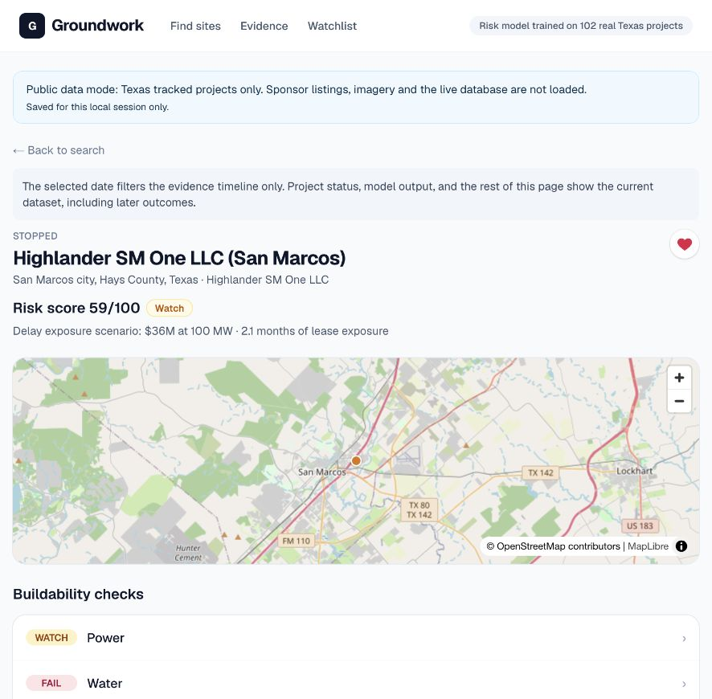
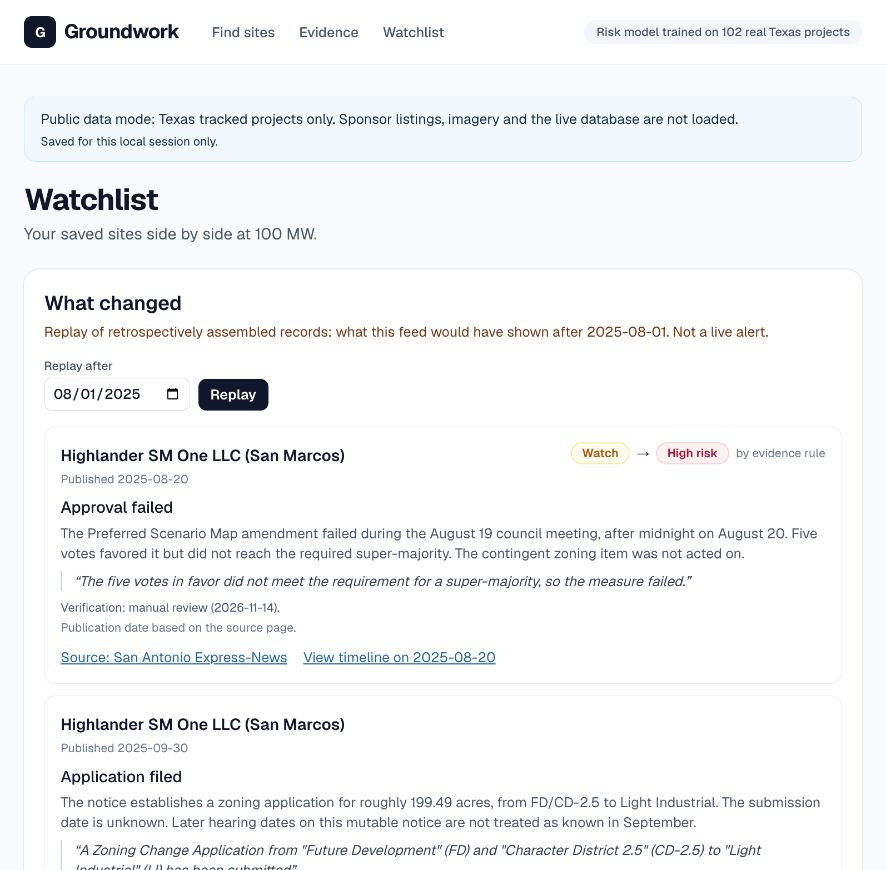

# Property walkthrough and supporting research demo

Data center siting decisions depend on evidence scattered across project records and local reporting. Groundwork brings those signals into one place for an early screening review.

## Start with property discovery

For the intended product, use the database-backed app with `DATA_MODE` unset and the database configured privately. Open `/`, choose Houston or Los Angeles, and open a CoStar prospect. Show the asking-price snapshot and property facts, the missing acquisition facts, and the screening checks. Explain that the maximum purchase price and full ten-year cost are not calculated yet. Use **Review this prospect** to record a next move, notes and diligence items; save and reload to show browser-local persistence. These saves do not write to the database.

Use imagery and 3D only if they actually load. Matterport-to-property matching and the terrain experience remain unverified. Nearby Texas projects are regional context, not evidence about this property. On the read-only database preview, do not use property hearts to demonstrate persistence: those use database writes and have not been verified. Do not present the current research tool as a property agent or a completed investment memo.

## Supporting research walkthrough (two minutes)

This demonstrates the evidence tools behind the product, not purchasable land or completed valuation. The following session uses public mode so the watchlist can be exercised without database writes.

Start the public app from the repository root in a terminal:

```sh
cd web && DATA_MODE=public npm run dev
```

Open the URLs below at `http://localhost:3000`. These steps use the checked-in public Texas data and the sample browser session. Resetting or restarting the development server can clear saved session state.

| Time | Open / do | Say |
| --- | --- | --- |
| 0:00–0:15 | Open [`/projects?status=all&q=San%20Marcos`](http://localhost:3000/projects?status=all&q=San%20Marcos). Show the matching cards and map pins. | “Groundwork brings local evidence and project records together for an early screening review.” |
| 0:15–0:40 | Open [`/sites/1c23acb7-4ec3-459b-aa99-1bd3104a4fb9?mw=100&asof=2025-08-19`](http://localhost:3000/sites/1c23acb7-4ec3-459b-aa99-1bd3104a4fb9?mw=100&asof=2025-08-19). Show Highlander SM One, stored score **59/100**/**Watch**, separately labeled held-out score **56/100**, the **$36M** 100 MW delay-exposure scenario, and checks. | “The $36 million scenario assumes 12 months of lease exposure. It is not a forecast.” |
| 0:40–0:55 | Change the timeline’s as-of date to `2025-08-20` and apply. Compare with August 19. | “The August 20 report raises the evidence level under our unvalidated rule; the model score and dollar scenario do not change.” |
| 0:55–1:10 | Change the as-of date to `2026-02-18` and apply, or open [`/sites/1c23acb7-4ec3-459b-aa99-1bd3104a4fb9?mw=100&asof=2026-02-18`](http://localhost:3000/sites/1c23acb7-4ec3-459b-aa99-1bd3104a4fb9?mw=100&asof=2026-02-18). | “The council denied the map amendment 5–2. Zoning was not heard; this is a later outcome, not a prior warning.” |
| 1:10–1:30 | Open [`/sites/4f2eaf6e-61e0-4721-8ac1-8f12718c64c8?mw=100&asof=2026-09-01`](http://localhost:3000/sites/4f2eaf6e-61e0-4721-8ac1-8f12718c64c8?mw=100&asof=2026-09-01), change the as-of date to `2026-09-02` to show the commission recommendation, then change it to `2026-09-08` to show the withdrawal record. The withdrawal date is the article’s publication day; the article does not state the calendar day the developer withdrew. | “Tomahawk’s commission recommended denial before the developer withdrew its proposal; the Town Council did not vote. The withdrawal record is dated by its September 8 publication.” |
| 1:30–1:40 | Return to [Highlander](http://localhost:3000/sites/1c23acb7-4ec3-459b-aa99-1bd3104a4fb9), save it with the heart, then open [`/watchlist?mw=100&since=2025-08-01`](http://localhost:3000/watchlist?mw=100&since=2025-08-01). | “The watchlist can replay evidence after August 1; public sessions are temporary.” |
| 1:40–2:00 | Open [`/evidence`](http://localhost:3000/evidence). Show the case-study table and its summary. | “Of four retrospectively researched stopped cases, two have a recorded qualifying raise before a stop-type outcome; two did not. Matrix has no prior raise; Athens has no outcome record. This is not a validation of the rule.” |

## Screenshots from the verified public walkthrough





## Retrospective case-study table

On the Evidence page, the table contains the cases that have fixture records: San Marcos, Matrix, Project Tomahawk, Athens, Sabey, CloudBurst, and Diode Ventures. The Tomahawk commission recommendation was published September 2; the CBS Texas withdrawal article was published September 8 and says the items were withdrawn before the council discussion, but does not state the withdrawal calendar day. The six-day lead uses the raise publication day and outcome publication day. Matrix’s construction suspension is dated by its January 21 publication day because the report does not state when construction halted. Athens has one project opposition record and one citywide ordinance record; neither raises its evidence level, and the ordinance is not a project-specific denial. Diode Ventures has the same city record because its recorded location is inside Athens city limits. Diode was not researched and is not a comparison case. Princeton and CoreWeave Denton were examined as the two selected comparisons, but neither supplied a fixture-eligible signal. The source log and verification details are in [EVIDENCE_SOURCES.md](EVIDENCE_SOURCES.md). The cases were assembled retrospectively under a fixed selection rule; this is not a validation of the evidence rule.

## City-wide context

After the timed walkthrough, open [Data Factory Athens on August 24, 2026](http://localhost:3000/sites/53035780-aaef-4edb-b279-eb8e2b5cc470?mw=100&asof=2026-08-24). The timeline shows its earlier project opposition and the later “City-wide: Athens” ordinance, with a KLTV source link. On August 23, only the opposition record is visible. The ordinance uses its publication time, August 24 at 8:40 PM EDT; the article says Monday night but does not give a separate event calendar day. Neither record is a qualifying raise or a project outcome.

[Diode Ventures on the same day](http://localhost:3000/sites/6251ccd6-f245-4bf4-bdf1-118825fa3123?mw=100&asof=2026-08-24) shows the city record only. It appears through the location matching rule, not new project research, and is not a comparison case. Both rows retain their original model band and dollar scenario. Save either project and replay after August 23 to show the city record without a band transition. City and county records remain context under the rule fixed before the research; changing that rule after seeing these results would tune it to the cases.

## Tracker labels and our review

This optional follow-up is outside the two-minute walkthrough. On [Athens](http://localhost:3000/sites/53035780-aaef-4edb-b279-eb8e2b5cc470#tracker-status), point to “Tracker status” and “Our review”: “The tracker calls this project defeated; the reviewed source describes a citywide ordinance, so it does not establish a project-specific defeat or its date.” On [Matrix](http://localhost:3000/sites/36a8e10f-045d-47b7-8e64-0319d509ce45#tracker-status), say: “The suspension kind agrees, but construction had already halted by the January report, before the tracker's September stop date; the exact halt day is unknown.” San Marcos's reviewed map-amendment denial agrees in kind and date. Tomahawk's withdrawal kind agrees, but its exact withdrawal day remains unestablished.

Open the [Training label check](http://localhost:3000/evidence#training-label-check): “We spot-checked four of the sixteen stopped training labels. Three were consistent in outcome kind, and one in date. Unestablished fields are not proof the tracker is wrong. The model still trains on the tracker's labels as given; this is not an audit.” The tracker snapshot and our review are retrospective, even when the timeline is filtered to an earlier date. Attribute tracker claims explicitly; describe sourced events only as narrowly as their reviewed records support.

## County-wide context

After the main walkthrough, open [Sabey in Hays County on February 16, 2026](http://localhost:3000/sites/4ed87767-70bd-4287-9af6-bff25ef45241?mw=100&asof=2026-02-16). Its timeline shows one record labeled “County-wide: Hays County”: the proposed water-permit pause. Move the date to February 15 to see zero known records. The record is context only; the project's model band and dollar scenario stay the same. The Water check links to the dated record, and the public project card shows its record count.

[CloudBurst in Hays County](http://localhost:3000/sites/c387151f-37d4-4196-b39e-8628bb5a7743?mw=100&asof=2026-02-16) receives the same county context. The Highlander SM One timeline still has the same four records and date transitions: three labeled “This project” and one county-wide record. Save Sabey, then use the [watchlist replay after February 1](http://localhost:3000/watchlist?mw=100&since=2026-02-01) to show its county record without a band transition. A county match is not evidence that a proposed rule applies to a particular permit.

## Optional local-only intake demonstration

This is outside the timed walkthrough. Start the development server with the intake flag enabled:

```sh
cd web && DATA_MODE=public ENABLE_EVIDENCE_INTAKE=true npm run dev
```

On the Highlander page, submit the verified quote and fields below:

- Source URL: `https://www.sanmarcostx.gov/m/newsflash/Home/Detail/2526`
- Publication date: `2025-09-30`
- Record type: `Application filed`
- Quote: `The Planning and Zoning Commission of the City of San Marcos, Texas, will hold a public hearing via hybrid, in-person / virtual, meeting at 6:00 p.m. on Tuesday, January 13, 2026, in the City Council Chambers, 630 E. Hopkins to consider the below request.`
- Summary: `The current application notice lists a January hearing; this mutable page does not establish when those hearing details first appeared.`

This quote was matched against extracted page text in a local intake demonstration. Intake verifies only that the quote appears in fetched text; it does not verify the claim or publication date. The date above is submitter-entered. Submissions are private to that session, appear from their recorded date, and are excluded from retrospective replay.

For the live-feed portion of this optional demo, save Highlander with its heart **before** submitting the quote. After submission, open [`/watchlist?mw=100`](http://localhost:3000/watchlist?mw=100) without a `since` parameter; that shows newly recorded session entries. Do not use the replay URL for this check because submitted records are excluded from retrospective replay. If the source page changes or blocks fetching, intake can refuse the quote; use a quote currently visible on the same public source page, and do not claim the earlier payload is guaranteed to work again. Keep intake off on any public deployment.

## Optional investigator configuration check

This is outside the timed walkthrough and is **not a live investigation demo**. Start the local server with `ENABLE_INVESTIGATOR=true` and leave `GEMINI_API_KEY` unset. The project page should show the deterministic investigation plan, the exact message “Investigator is not configured”, and a disabled Investigate button. This confirms the no-key UI only; the Gemini 4 Carbon Interactions API adapter with Google Search grounding and structured JSON output is **not tested against the live service**. Google's current documentation marks the combination preview; no authenticated request was made and live account access, schema behavior, errors, and latency remain unverified. See the [model](https://aistudio.google.com/docs/models/gemini-4-carbon), [Interactions API](https://aistudio.google.com/api-reference/interactions-api/create-interaction), [Google Search grounding](https://aistudio.google.com/docs/google-search), and [structured output with tools](https://aistudio.google.com/docs/structured-output#tools) pages reviewed on November 14, 2026. Do not claim a live AI investigator until a live run has actually been performed and reviewed.

## Keep the claims precise

- The model label is **stopped**, not delayed. Its features are today's snapshot; this is not a historical backtest, and its score is not a calibrated probability.
- The “Tracker status” is the tracker's claim. “Our review” checks only the cited material; an unestablished field does not prove the tracker wrong, and the four-case spot check is not an audit.
- The dollar amount is an assumed 12-month scenario using a lease-rate assumption. It is not a forecast, appraisal, or transaction recommendation.
- The stored project score is **59/100**; the timeline's separately labeled held-out demonstration score is **56/100** (raw score 0.569606). The held-out score is used as the timeline evidence baseline and does not drive the stored score or dollar scenario.
- The optional Gemini investigator has **not been tested against the live service**. Its panel may show a plan without a key, but this does not demonstrate a live model run.
- The evidence rule is a demonstrative rule, not a statistically validated model. The San Marcos timeline was assembled retrospectively.
- Do not call the August 2025 Preferred Scenario Map amendment a zoning vote. The contingent zoning item was not acted on. On February 18, 2026, the Preferred Scenario Map amendment was denied 5–2; the zoning change was not heard or voted on. That later report is an outcome record.
- Do not claim a live AI investigator, investment memo, maximum land price, orbit comparison, or on-chain attestation.
- This walkthrough does not verify database mode, sponsor integrations, deployment, durable storage, or intake safety for public deployment.
